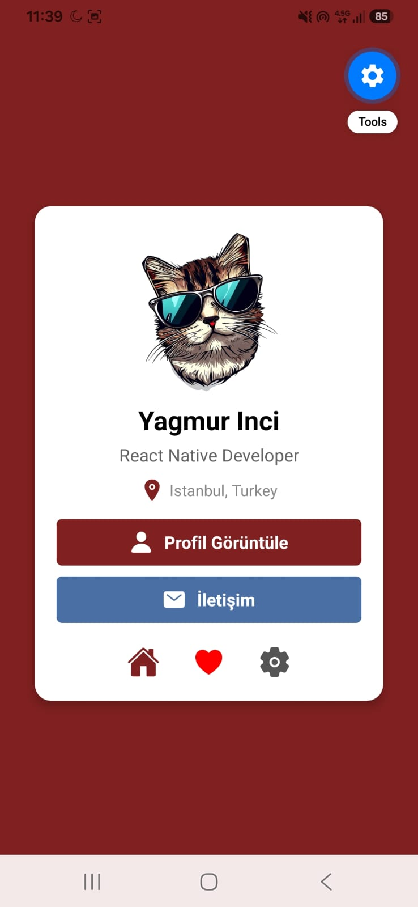

# 📱 Hafta 3 (2) Lab: Gelişmiş Profil & Menü Kartı Uygulaması

Bu proje, **Mobil Programlama** dersi 3. hafta ikinci laboratuvar çalışması kapsamında geliştirilmiştir. Temel profil kartı yapısı geliştirilerek yerel varlık yönetimi (local assets), çoklu buton grupları ve alt gezinme ikon menüsü eklenmiştir.

---

## 📸 Ekran Görüntüsü

> **Not:** Uygulamanın ekran görüntüsünü bu alana yerleştirmek için görselinizi `Hafta3_2Lab/screenshots/gelismis-profil.png` konumuna ekleyebilirsiniz.

| Gelişmiş Profil Kartı |
| :---: |
| <br><sub><b>Şekil 1: Gelişmiş Profil ve Menü Kartı Arayüzü</b></sub> |

---

## 🚀 Proje Özellikleri

- **Yerel Görsel Varlığı (`require('./assets/caticon2.png')`):** Proje dizininde yer alan yüksek çözünürlüklü avatar görseli entegre edilmiştir.
- **Çoklu Eylem Butonları:**
  - **Profil Görüntüle Butonu:** Bordo renk temalı birincil eylem butonu.
  - **İletişim Butonu:** Mavi tonlu (`#4a6fa5`) ikincil iletişim eylemi butonu.
- **Alt Eylem ve Gezinme Menüsü (`menu`):**
  - 🏠 **Ana Sayfa:** Bordo renkli ev ikonu
  - ❤️ **Favoriler:** Canlı kırmızı renkli kalp ikonu
  - ⚙️ **Ayarlar:** Gri tonlu ayarlar ikonu
- **Gölge & Kart Derinliği:** `elevation: 5` ve `borderRadius: 15` ile kart görünümüne derinlik kazandırılmıştır.

---

## 🛠️ Kullanılan Teknolojiler ve Bileşenler

- **React & React Native:** `0.86.3` / `19.2.3`
- **Expo SDK:** `~57.0.28`
- **İkon Paketi:** `@expo/vector-icons` (`Ionicons`)
- **Bileşenler:**
  - `View`: Flexbox düzeni, dikey ve yatay gruplandırma (`flexDirection: 'row'`, `gap`)
  - `Text`: Başlık, açıklama ve buton etiketleri
  - `Image`: Yerel resim dosyası gösterimi
  - `Pressable`: Dokunmatik buton ve menü etkileşimleri
  - `StyleSheet`: Tasarım ve arayüz stilleri

---

## 📂 Dosya Yapısı

```
Hafta3_2Lab/
├── App.js              # Gelişmiş profil kartı bileşeni
├── index.js            # Expo kök kayıt dosyası
├── assets/             # Yerel görseller ve ikonlar
│   ├── caticon2.png    # Profil avatar görseli
│   ├── catIcon.png
│   └── girlicon.png
├── screenshots/        # Ekran görüntüleri klasörü
│   └── .gitkeep
├── app.json            # Expo yapılandırması
├── package.json        # Paket bağımlılıkları
└── README.md           # Proje dokümantasyonu
```

---

## 💻 Kurulum ve Çalıştırma

Projeyi yerel ortamınızda ayağa kaldırmak için:

1. **İlgili dizine geçin:**
   ```bash
   cd Hafta3_2Lab
   ```

2. **Gerekli paketleri kurun:**
   ```bash
   npm install
   ```

3. **Expo sunucusunu başlatın:**
   ```bash
   npx expo start
   ```

4. **Uygulamayı Açın:**
   - Expo Go uygulamasından QR kodu okutabilir veya terminalden `a` (Android) / `w` (Web) seçeneklerini kullanabilirsiniz.
