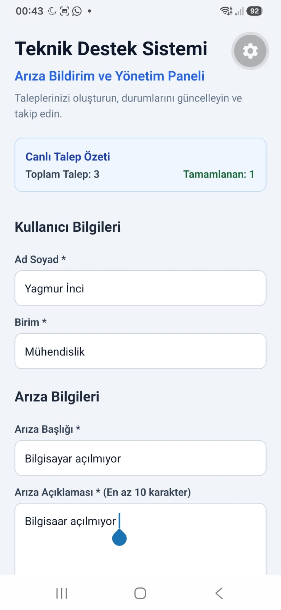
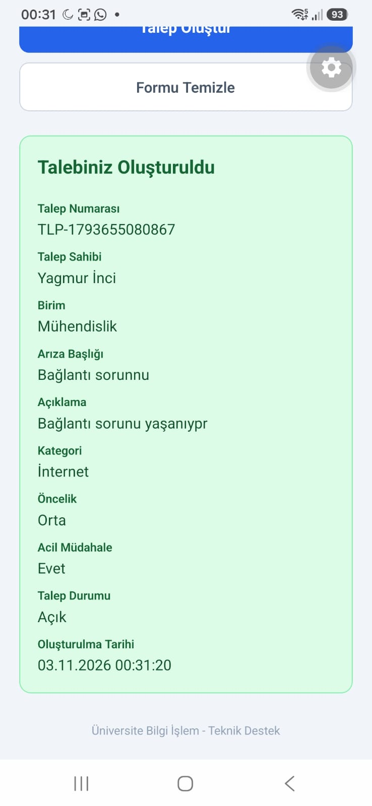

# 📋 Hafta 4 (2) Lab: Teknik Destek Talep Oluşturma Formu

Bu proje, **Mobil Programlama** dersi 4. hafta ikinci laboratuvar çalışması kapsamında geliştirilmiştir. Kullanıcıların teknik arıza ve destek taleplerini eksiksiz, doğrulanmış (validated) ve yapılandırılmış şekilde bildirebilmelerini sağlayan **Teknik Destek Formu** uygulamasıdır.

---

## 📸 Ekran Görüntüleri

> **Not:** Ekran görüntülerinizi `Hafta4_2Lab/screenshots/` klasörüne aşağıdaki dosya adlarıyla ekleyebilirsiniz.

| 1. Arıza Bildirim Formu | 2. Oluşturulan Talep Özeti |
| :---: | :---: |
| <br><sub><b>Şekil 1: Giriş Alanları, Kategori & Öncelik Seçimi</b></sub> | <br><sub><b>Şekil 2: Başarılı Gönderim Sonrası Son Talep Kartı</b></sub> |

---

## 🚀 Proje Özellikleri

### 1. Kapsamlı Form Giriş Alanları
- **Ad Soyad:** Otomatik kelime büyük harf duyarlılığı (`autoCapitalize="words"`).
- **Birim:** Talep sahibinin fakülte veya idari birim bilgisi.
- **Arıza Başlığı:** Sorunun kısa özeti.
- **Arıza Açıklaması:** Çok satırlı geniş metin alanı (`multiline={true}`, `textAlignVertical="top"`).

### 2. Etkileşimli Seçim Elemanları
- **Kategori Seçimi:** *Bilgisayar*, *Yazıcı*, *İnternet* ve *Yazılım* butonları arasından aktif seçim.
- **Öncelik Düzeyi:** *Düşük*, *Orta*, *Yüksek* seviyeleri arasında renk geçişli seçim.
- **Acil Müdahale Switch'i:** Kritik durumlar için boolean geçiş anahtarı (`Switch`).

### 3. Form Doğrulama (Validation) & Uyarılar
- Zorunlu alanların (`adSoyad`, `birim`, `baslik`) boş geçilmesini engelleme.
- Açıklamanın en az **10 karakter** olmasını zorunlu tutma.
- Kategori seçiminin yapıldığını denetleme.
- Hatalı veya eksik durumlarda `Alert.alert` ile anlık geri bildirim.

### 4. Form Temizleme ve Başarılı Gönderim Kartı
- **Formu Temizle:** Tüm alanları başlangıç değerlerine sıfırlama.
- **Son Talep Kartı:** Başarıyla oluşturulan talebin benzersiz ID (`TLP-timestamp`), tarih ve tüm parametreleriyle birlikte yeşil tonlu sonuç kartında anında görüntülenmesi.

---

## 🛠️ Kullanılan Teknolojiler ve Bileşenler

- **React & React Native:** `0.88.1` / `19.3.0`
- **Expo SDK:** `^58.0.22`
- **Kullanılan Kancalar ve Bileşenler:**
  - `useState`: Form alanlarının durum kontrolü
  - `TextInput`: Metin ve çok satırlı açıklama girişleri
  - `Switch`: Acil durum açık/kapalı kontrolü
  - `ScrollView`: Klavye ve küçük ekranlara uyumlu kaydırılabilir içerik (`keyboardShouldPersistTaps="handled"`)
  - `Alert`: Doğrulama ve bilgilendirme pencereleri
  - `SafeAreaView` & `StatusBar`: Cihaz arayüz uyumluluğu

---

## 📂 Dosya Yapısı

```
Hafta4_2Lab/
├── App.js              # Teknik Destek Formu ana bileşeni
├── index.js            # Kök kayıt dosyası
├── components/         # Kart ve rozet bileşenleri
├── data/               # Model ve örnek veri dosyaları
├── assets/             # Görseller ve ikonlar
├── screenshots/        # Ekran görüntüleri klasörü
│   └── .gitkeep
├── app.json            # Yapılandırma dosyası
├── package.json        # Paket bağımlılıkları
└── README.md           # Proje dokümantasyonu
```

---

## 💻 Kurulum ve Çalıştırma

Projeyi çalıştırmak için:

1. **Dizine geçin:**
   ```bash
   cd Hafta4_2Lab
   ```

2. **Bağımlılıkları kurun:**
   ```bash
   npm install
   ```

3. **Uygulamayı başlatın:**
   ```bash
   npx expo start
   ```
