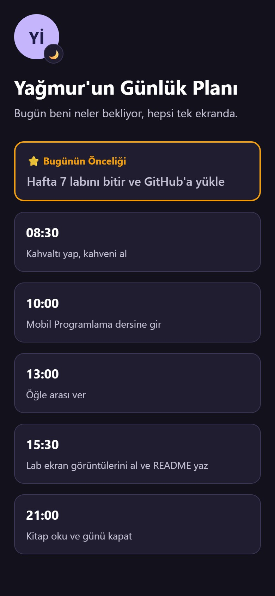
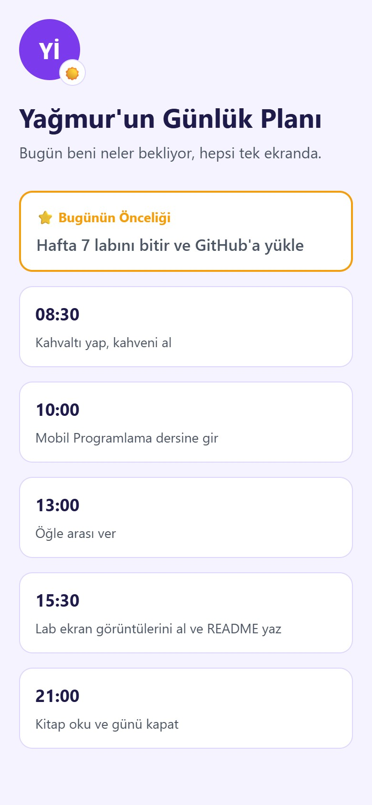

# 🌗 Hafta 7 Lab: Tema Uyumlu Günlük Plan Ekranı

Bu proje, **Mobil Programlama** dersi 7. hafta laboratuvar çalışması (Mini Görev) kapsamında geliştirilmiştir. Derste oluşturulan **özel tema bileşenleri** (`ThemedView`, `ThemedLogo`, `ThemedText`, `ThemedCard`, `Spacer`) gerçek bir sayfa üzerinde bir araya getirilerek, cihazın **açık / koyu temasına** göre kendiliğinden uyum sağlayan bir **"Günlük Planım"** ekranı hazırlanmıştır.

---

## 📸 Ekran Görüntüleri

| Koyu Tema (Dark Mode) | Açık Tema (Light Mode) |
| :---: | :---: |
| <br><sub><b>Şekil 1: Koyu Temada Günlük Plan Ekranı</b></sub> | <br><sub><b>Şekil 2: Açık Temada Günlük Plan Ekranı</b></sub> |

---

## 🚀 Proje Mimarisi ve Bileşenler

### 🌟 Ana Ekran (`app/index.jsx`)
Kullanıcının gün içinde yapacağı işleri tek ekranda gösterir. Yukarıdan aşağıya sırasıyla:
- **Logo:** Temaya göre renk ve rozet (☀️ / 🌙) değiştiren `ThemedLogo`.
- **Başlık ve Açıklama:** `title` özelliği ile yazılan başlık ve altında normal metin.
- **Bugünün Önceliği Kartı (Ek Görev):** Turuncu çerçeveyle diğerlerinden ayrılan öncelik kartı.
- **Görev Kartları:** `GUNLUK_PLAN` dizisi `map()` ile dolaşılarak her görev için bir `ThemedCard` üretilir (5 adet).
- Kartlar ekrana sığmadığında kaydırma için `ScrollView`, çentik payı için `useSafeAreaInsets` kullanılmıştır.

### 🎨 Tema Altyapısı
- **Renk Paleti (`constants/Colors.js`):** `light` ve `dark` adında, aynı anahtarlara (`background`, `uiBackground`, `border`, `title`, `text`…) sahip iki palet içerir. Bütün renkler tek dosyada durur.
- **Tema Hook'u (`hooks/useTheme.js`):** React Native'in `useColorScheme()` kancası ile aktif temayı okur ve doğru paleti döndürür. Beş bileşenin tamamı rengini bu hook üzerinden alır.

### 🧩 Özel Bileşenler (`components/`)
| Bileşen | Görevi |
| :--- | :--- |
| **`ThemedView`** | Sayfanın ana kapsayıcısıdır; arka plan rengini temadan alır. |
| **`ThemedText`** | `title` verilirse başlık rengi ve kalın yazı, verilmezse normal metin rengi uygular. |
| **`ThemedCard`** | Köşeleri yuvarlak, çerçeveli kart; zemin ve çerçeve rengi temadan gelir. |
| **`ThemedLogo`** | Kodla çizilen baş harfli logo; açık ve koyu temada farklı renk ve rozet gösterir. |
| **`Spacer`** | Bileşenler arasında düzenli boşluk bırakan görünmez yardımcı bileşen. |

---

## ✅ Görev Gereksinimleri

| Gereksinim | Durum |
| :--- | :---: |
| 1 adet `ThemedView` (ana kapsayıcı) | ✅ |
| 1 adet `ThemedLogo` | ✅ |
| Başlık amaçlı `ThemedText` (`title`) | ✅ |
| En az 3 adet `ThemedCard` (6 kart) | ✅ |
| Kartlar arasında `Spacer` | ✅ |
| Ek Görev: "Bugünün Önceliği" kartı | ✅ |
| Dark mode testi (`userInterfaceStyle: "dark"`) | ✅ |

---

## 🛠️ Kullanılan Teknolojiler

- **Expo:** `~58.0.22`
- **Expo Router:** `~58.0.29` (Dosya tabanlı yönlendirme, başlık çubuğu gizli Stack)
- **React & React Native:** `19.3.0` / `0.88.1`
- **Tema Yönetimi:** `useColorScheme()` + özel `useTheme` hook'u
- **Diğer:** `react-native-safe-area-context` (çentik payı), `expo-status-bar` (temaya uyumlu durum çubuğu)

### 🌙 Temayı Değiştirme
`app.json` dosyasındaki `userInterfaceStyle` değeri temayı belirler:
- `"dark"`: Uygulama her zaman koyu temada açılır (bu projedeki ayar).
- `"light"`: Uygulama her zaman açık temada açılır.
- `"automatic"`: Uygulama cihazın sistem temasını takip eder.

---

## 📂 Dosya Yapısı

```
Hafta7Lab/
├── app/
│   ├── _layout.jsx             # Kök Stack (varsayılan başlık çubuğu gizli)
│   └── index.jsx               # Günlük Plan ekranı
├── components/
│   ├── ThemedView.jsx          # Tema uyumlu kapsayıcı
│   ├── ThemedText.jsx          # Tema uyumlu metin (title desteği)
│   ├── ThemedCard.jsx          # Tema uyumlu kart
│   ├── ThemedLogo.jsx          # Tema uyumlu logo
│   └── Spacer.jsx              # Boşluk bileşeni
├── constants/
│   └── Colors.js               # Açık / koyu tema renk paleti
├── hooks/
│   └── useTheme.js             # Aktif temayı veren özel hook
├── screenshots/                # Ekran görüntüleri klasörü
│   ├── gunluk-plan-koyu-tema.jpeg
│   └── gunluk-plan-acik-tema.jpeg
├── app.json                    # Expo konfigürasyonu (userInterfaceStyle)
├── package.json                # Bağımlılıklar
└── README.md                   # Proje dokümantasyonu
```

---

## 💻 Kurulum ve Çalıştırma

Projeyi çalıştırmak için:

1. **Dizine geçin:**
   ```bash
   cd Hafta7Lab
   ```

2. **Bağımlılıkları yükleyin:**
   ```bash
   npm install
   ```

3. **Uygulamayı başlatın:**
   ```bash
   npx expo start
   ```

4. **Kullanım:** Terminal üzerinden `a` (Android) veya `w` (Web) seçerek ekranı açabilir, `app.json` içindeki `userInterfaceStyle` değerini değiştirerek açık ve koyu tema farkını gözlemleyebilirsiniz.
