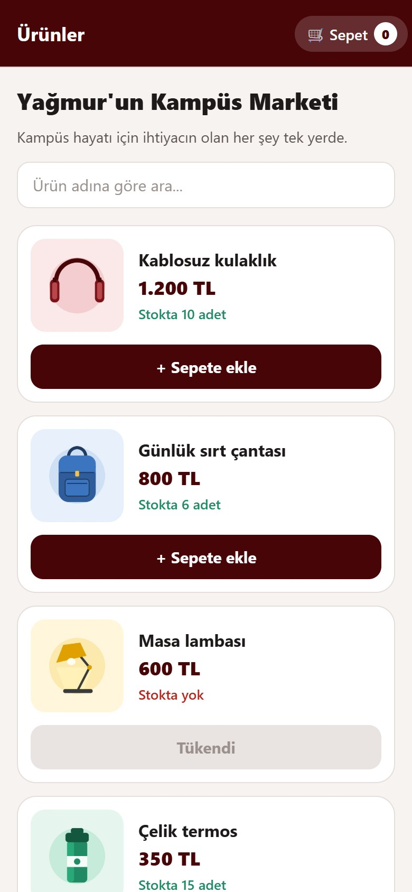
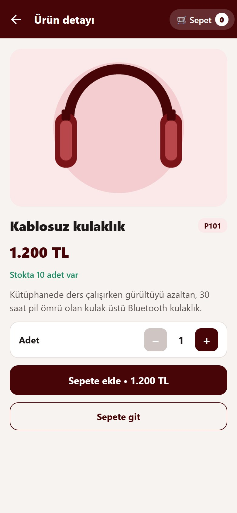
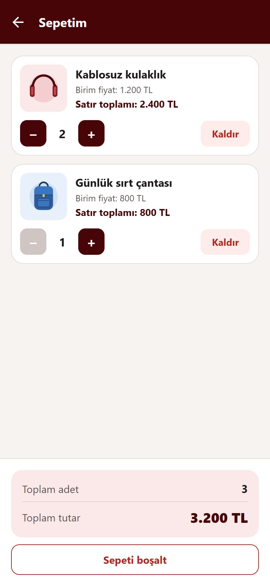
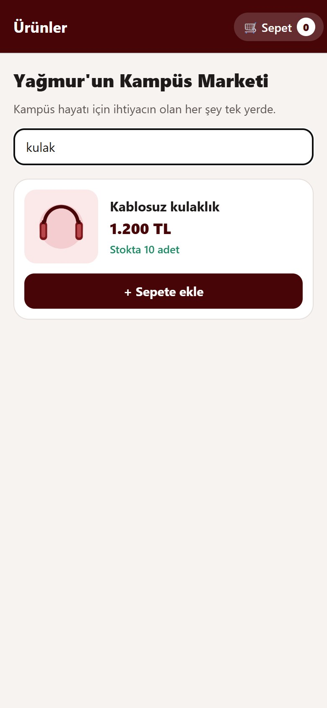
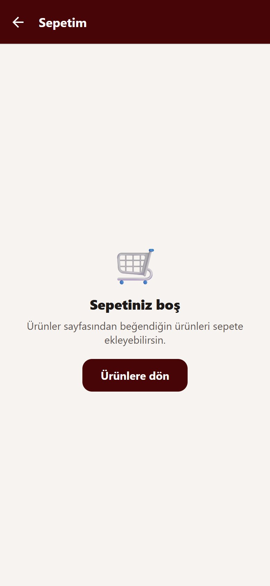

# 🛒 Hafta 7 (2) Lab: Kampüs Market Uygulaması

Bu proje, **Mobil Programlama** dersi **Kampüs Market Laboratuvar Föyü** kapsamında geliştirilmiştir. JavaScript ile **boş (blank) Expo şablonundan** başlanmış, Expo Router elle kurulmuş ve ürün listesi, ürün detayı ve sepet ekranlarından oluşan **çok ekranlı bir alışveriş uygulaması** hazırlanmıştır. Sepet, **Context API** ile bütün ekranların ortak kullandığı tek bir yerde tutulur.

Geliştirici: **[Yağmur İnci](https://github.com/YagmurInci)**

---

## 📸 Ekran Görüntüleri

| Ürün Listesi | P101 Ürün Detayı | Sepet (Toplam 3.200 TL) |
| :---: | :---: | :---: |
| <br><sub><b>Şekil 1: Ürün Listesi ve Arama Kutusu</b></sub> | <br><sub><b>Şekil 2: P101 Detayı ve Adet Seçimi</b></sub> | <br><sub><b>Şekil 3: 2 Kulaklık + 1 Çanta = 3.200 TL</b></sub> |

| Ada Göre Arama | Boş Sepet |
| :---: | :---: |
| <br><sub><b>Şekil 4: "kulak" Araması</b></sub> | <br><sub><b>Şekil 5: Boş Sepet Mesajı ve Ürünlere Dönüş</b></sub> |

---

## 🚀 Proje Mimarisi ve Ekranlar

### 🏠 Ürünler (`app/index.jsx`)
- `data/urunler.js` içindeki ürünleri **`FlatList`** ile görsel, ad, fiyat ve stok bilgisiyle listeler.
- **`TextInput` + `useState` + `filter`** ile ada göre arama yapar; sonuç yoksa *"Aramanıza uygun ürün bulunamadı"* mesajı gösterir.
- Her kart kendi ürününün kimliğini detay sayfasına gönderir ve ürünü **1 adet** sepete ekler.
- Ekleme sonucu (başarılı / stok sınırı) ekranın üstünde bilgi şeridi olarak görünür.

### 🔎 Ürün Detayı (`app/urun/[id].jsx`)
- **`useLocalSearchParams()`** ile adresteki `id` okunur ve ürün dizisinde aranır.
- Fotoğraf, ad, fiyat, açıklama ve stok bilgisi gösterilir; `useState(1)` ile tutulan adet **`AdetSecici`** ile değiştirilir.
- Kimlik bulunamazsa *"Ürün bulunamadı"* mesajı ve **Ürünlere dön** düğmesi çıkar; stok sıfırsa ekleme kapatılır.

### 🧺 Sepetim (`app/sepet.jsx`)
- Her satırda birim fiyat, adet, satır toplamı ve **Kaldır** düğmesi bulunur.
- Artı / eksi düğmeleri yerel bir sayaç yerine **ortak sepet fonksiyonlarını** çağırır.
- Toplam adet ve toplam tutar **`reduce`** ile her çizimde yeniden hesaplanır, ayrı state'te tutulmaz.
- Sepet boşsa mesaj ve ürünlere dönüş düğmesi gösterilir.

### 🧩 Hangi Dosya Ne Yapar?
| Dosya | Görevi |
| :--- | :--- |
| **`app/_layout.jsx`** | Ortak `Stack` navigatörü ve bütün ekranları saran `SepetProvider`. |
| **`app/index.jsx`** | Ürün listesi ve ada göre arama. |
| **`app/urun/[id].jsx`** | Kimliğe göre ürün detayı, adet seçimi ve sepete ekleme. |
| **`app/sepet.jsx`** | Sepet satırları, artırma / azaltma / kaldırma ve toplamlar. |
| **`components/UrunKarti.jsx`** | Tek ürünün tekrar kullanılabilir kartı (`urun`, `onDetay`, `onSepeteEkle`). |
| **`components/AdetSecici.jsx`** | Artı ve eksi düğmeleri (`adet`, `onArtir`, `onAzalt`). |
| **`components/SepetOzeti.jsx`** | Toplam adet ve toplam tutar (`toplamAdet`, `toplamTutar`). |
| **`components/SepetDugmesi.jsx`** | Başlıktaki sepet düğmesi; üzerindeki sayı toplam adedi gösterir. |
| **`components/DurumMesaji.jsx`** | Ekleme sonucunu gösteren bilgi şeridi. |
| **`context/SepetContext.jsx`** | Ortak sepet state'i, işlemleri ve `useSepet` hook'u. |
| **`data/urunler.js`** | Yerel ürün dizisi (fiyatlar sayı olarak tutulur). |
| **`utils/para.js`** | Sayıyı `1.200 TL` biçiminde yazan yardımcı fonksiyon. |
| **`constants/Renkler.js`** | Uygulamanın renk paleti. |

### 🧠 Sepet Neden Ortak Provider İçinde?
Sepet tek bir ekranın `useState`'inde tutulsaydı diğer ekranlar o veriyi göremezdi; listeden eklenen ürün sepet ekranına ulaşmazdı. Bu yüzden sepet, `app/_layout.jsx` içinde `Stack`'in **dışında** ve bütün ekranların **üstünde** duran tek bir `SepetProvider`'da tutulur. Ürünler, Ürün detayı ve Sepetim ekranları `useSepet()` hook'u ile **aynı** sepeti okur ve aynı fonksiyonlarla günceller; listeden ya da detaydan eklenen ürün aynı sepette görünür. Her sayfaya ayrı Provider konsaydı her ekranın kendi ayrı sepeti oluşurdu.

### 🧮 Sepet Fonksiyonları
| Fonksiyon | Yaptığı İş |
| :--- | :--- |
| `sepeteEkle(urun, adet)` | Ürünü ekler; mevcutsa adedine ekler. Pozitif tam sayı ve stok kontrolü yapar. |
| `adetArtir(id)` | Satırı bir artırır; stok sınırını aşmaz. |
| `adetAzalt(id)` | Satırı bir azaltır; adet 1 ise değiştirmez. |
| `urunKaldir(id)` | Satırı sepetten çıkarır. |
| `sepetiBosalt()` | Sepeti boş dizi yapar. |

> Güncellemeler `setSepet(onceki => ...)` biçiminde yapılır; dizi `push` ile değiştirilmez, `map` / `filter` ile yeni dizi üretilir. Stok satın alınmış gibi azalmaz, yalnızca sepete konabilecek en fazla adedi sınırlar.

---

## ✅ Föy Gereksinimleri

| Gereksinim | Durum |
| :--- | :---: |
| En az üç ürünü görsel, ad ve fiyatla listeleme (5 ürün) | ✅ |
| Ada göre arama | ✅ |
| Ürünü kimliğiyle bulma, adet seçimi ve sepete ekleme | ✅ |
| Sepette artırma, azaltma ve kaldırma | ✅ |
| Liste ve detaydan eklenen ürünün aynı sepette görünmesi | ✅ |
| Listeden detaya, liste ve detaydan sepete gezinme; geri dönüş | ✅ |
| Güvenli alan (`SafeAreaView`, `edges={['bottom','left','right']}`) | ✅ |
| Stok kontrolü ve stoksuz üründe eklemenin kapatılması | ✅ |
| Düğmelerde erişilebilirlik açıklamaları | ✅ |

### 🧪 Son Kontrol Senaryosu
| Deneme | Sonuç |
| :--- | :--- |
| P101 kulaklığı iki kez ekle | Tek satır, adet 2, toplam **2.400 TL** |
| P102 çantayı bir kez ekle | İki satır, toplam adet 3, toplam **3.200 TL** |
| Kulaklığı bir azalt | Toplam adet 2, tutar **2.000 TL** |
| Çantayı kaldır | Yalnız bir kulaklık, toplam **1.200 TL** |
| Adet 1 iken eksiye bas | Adet 1 kalır |
| Stoksuz lambayı eklemeyi dene | Düğme kapalı, "Tükendi" görünür |
| Stok sınırını aşmayı dene | Ekleme / artırma engellenir, uyarı görünür |
| Sepeti boşalt | "Sepetiniz boş" mesajı görünür |

---

## 🛠️ Kullanılan Teknolojiler

- **Expo:** `~58.0.25` (blank JavaScript şablonu)
- **Expo Router:** `~58.0.31` (dosya tabanlı Stack navigasyon, `[id]` dinamik rota)
- **React & React Native:** `19.3.0` / `0.88.1`
- **Durum Yönetimi:** `createContext` + `useContext` + `useState`
- **Güvenli Alan:** `react-native-safe-area-context`
- **Diğer:** `react-native-screens`, `expo-linking`, `expo-constants`, `expo-status-bar`

---

## 📂 Dosya Yapısı

```
Hafta7_2Lab/
├── app/
│   ├── _layout.jsx             # Ortak Stack + SepetProvider
│   ├── index.jsx               # Ürün listesi ve arama
│   ├── sepet.jsx               # Sepet işlemleri
│   └── urun/
│       └── [id].jsx            # Kimliğe göre ürün detayı
├── components/
│   ├── UrunKarti.jsx           # Ürün kartı
│   ├── AdetSecici.jsx          # Artı / eksi düğmeleri
│   ├── SepetOzeti.jsx          # Toplam adet ve tutar
│   ├── SepetDugmesi.jsx        # Başlıktaki sepet düğmesi
│   └── DurumMesaji.jsx         # Bilgi şeridi
├── context/
│   └── SepetContext.jsx        # Ortak sepet state'i ve useSepet hook'u
├── data/
│   └── urunler.js              # Yerel ürün dizisi
├── utils/
│   └── para.js                 # Fiyat biçimlendirme
├── constants/
│   └── Renkler.js              # Renk paleti
├── assets/                     # Ürün görselleri ve uygulama ikonları
├── screenshots/                # Ekran görüntüleri klasörü
├── app.json                    # Expo konfigürasyonu (scheme, expo-router eklentisi)
├── package.json                # Bağımlılıklar ("main": "expo-router/entry")
└── README.md                   # Proje dokümantasyonu
```

---

## 💻 Kurulum ve Çalıştırma

Projeyi çalıştırmak için:

1. **Dizine geçin:**
   ```bash
   cd Hafta7_2Lab
   ```

2. **Bağımlılıkları yükleyin:**
   ```bash
   npm install
   ```

3. **Uygulamayı başlatın:**
   ```bash
   npx expo start --clear
   ```

4. **Kullanım:** Terminaldeki QR kodu **Expo Go** ile okutabilir veya `a` (Android) / `w` (Web) seçerek uygulamayı açabilirsiniz. Uygulama yeniden başlatıldığında sepetin boşalması bu labda beklenen davranıştır; kalıcı kayıt yapılmaz.
