# 📱 Mobil Programlama Dersi Laboratuvar Projeleri

Bu depo, **Mobil Programlama** dersi kapsamında geliştirilen haftalık laboratuvar çalışmalarını, React Native bileşen pratiklerini ve Expo tabanlı mobil uygulamaları içermektedir.

Geliştirici: **[Yağmur İnci](https://github.com/YagmurInci)**

---

## 📑 İçindekiler ve Proje Dizini

| Hafta / Proje | Başlık | Açıklama | Teknoloji & Kütüphaneler | Durum |
| :--- | :--- | :--- | :--- | :---: |
| **[Hafta 3 Lab](./Hafta3Lab/)** | Kişisel Profil Kartı | Uzak resim, unvan, konum ve etkileşimli buton içeren profil kartı tasarımı. | React Native, Expo, Ionicons | ✅ Tamamlandı |
| **[Hafta 3 (2) Lab](./Hafta3_2Lab/)** | Gelişmiş Profil & Menü Kartı | Yerel varlıklar, çoklu aksiyon butonları ve alt navigasyon çubuğu. | React Native, Local Assets, Ionicons | ✅ Tamamlandı |
| **[Hafta 4 Lab](./Hafta4Lab/)** | Teknik Destek Paneli | FlatList, duruma göre filtreleme, responsive KPI özet kartları ve canlı durum döngüsü. | FlatList, useWindowDimensions, useState | ✅ Tamamlandı |
| **[Hafta 4 (2) Lab](./Hafta4_2Lab/)** | Arıza Bildirim Formu | Giriş alanları, çok satırlı metin, switch anahtarı, doğrulama ve dinamik sonuç kartı. | TextInput, Switch, ScrollView, Alert | ✅ Tamamlandı |
| **[Hafta 5 Lab](./Hafta5Lab/)** | Arıza Yönetim & Canlı İstatistik | Canlı talep istatistiği, modal ile detay inceleme & durum değiştirme, uzun basma ile silme. | Modal, onLongPress, Realtime Stats | ✅ Tamamlandı |
| **[Hafta 6 Lab](./Hafta6Lab/)** | Çok Sayfalı Expo Router Uygulaması | Dosya tabanlı Stack navigasyon ile Arıza Takip, Ürün Kataloğu ve Ders Programı modülleri. | Expo Router, Stack, [id] Rotaları | ✅ Tamamlandı |
| **[Hafta 7 Lab](./Hafta7Lab/)** | Tema Uyumlu Günlük Plan Ekranı | Açık/koyu temaya göre kendiliğinden değişen özel bileşenlerle hazırlanmış günlük plan ekranı. | useColorScheme, Themed Bileşenler, Özel Hook | ✅ Tamamlandı |
| **[my-app](./my-app/)** | Expo Router & TypeScript Şablonu | TypeScript destekli, çift sekmeli, açık/koyu tema uyumlu başlangıç şablonu. | TypeScript, Expo Tabs, Themes | ✅ Tamamlandı |

---

## 🖼️ Proje Vitrini ve Ekran Görüntüleri

> 💡 **Görselleri Ekleme Rehberi:** Sayfa ekran görüntülerinizi her bir projenin içerisindeki `screenshots/` klasörüne ekleyebilirsiniz. Aşağıdaki tablolarda görseller için hazır alanlar oluşturulmuştur.

### 📌 1. Hafta 3: Profil Kartı Uygulamaları
| Hafta 3 Temel Profil | Hafta 3 Gelişmiş Profil & Menü |
| :---: | :---: |
| 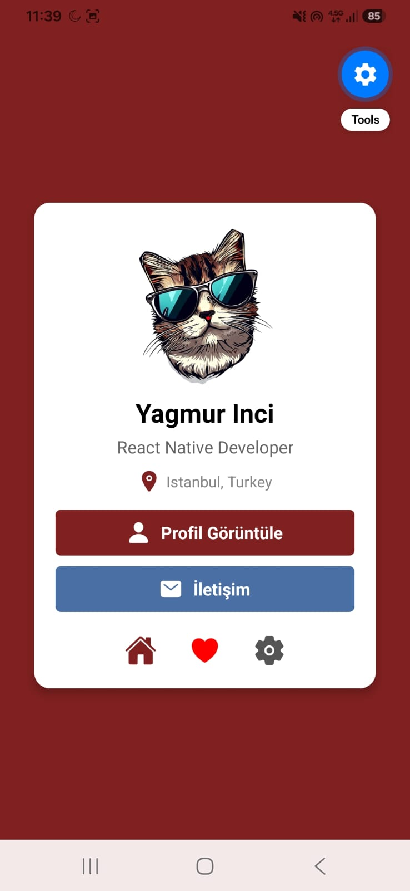<br><sub><b>Hafta 3 Lab: Kişisel Profil Kartı</b></sub> | <br><sub><b>Hafta 3 (2) Lab: Buton Grubu & Alt Menü</b></sub> |

---

### 📌 2. Hafta 4: Destek Paneli ve Form Yönetimi
| Hafta 4 Teknik Destek Paneli | Hafta 4 (2) Arıza Bildirim Formu |
| :---: | :---: |
| 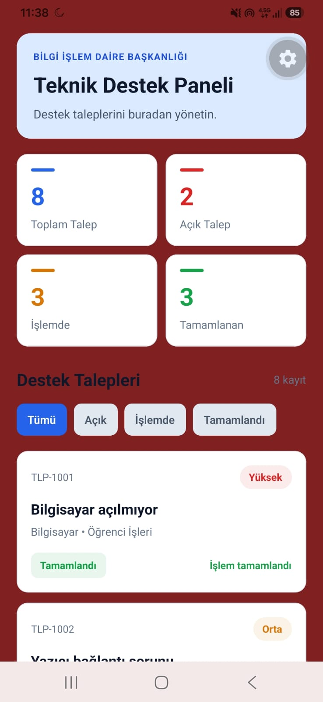<br><sub><b>Hafta 4 Lab: FlatList & KPI Kartları</b></sub> | 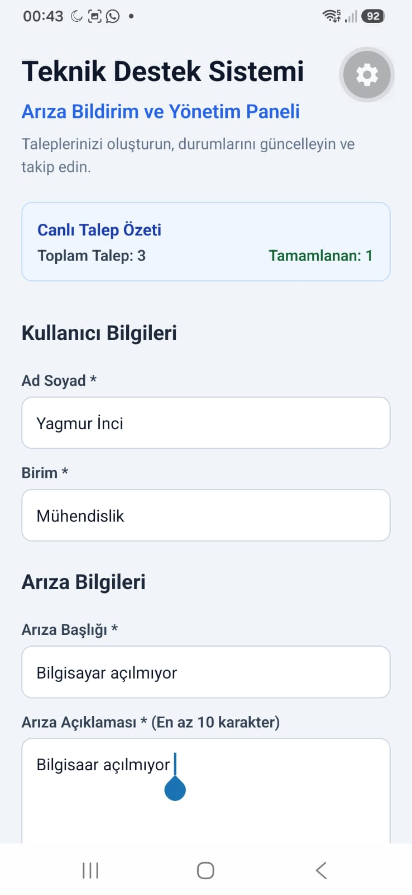<br><sub><b>Hafta 4 (2) Lab: Form Alanları & Switch</b></sub> |

---

### 📌 3. Hafta 5: Canlı İstatistik ve Modal Yönetimi
| Hafta 5 Liste & Canlı İstatistik | Hafta 5 Detay Modalı | Hafta 5 Uzun Basma ile Silme |
| :---: | :---: | :---: |
| 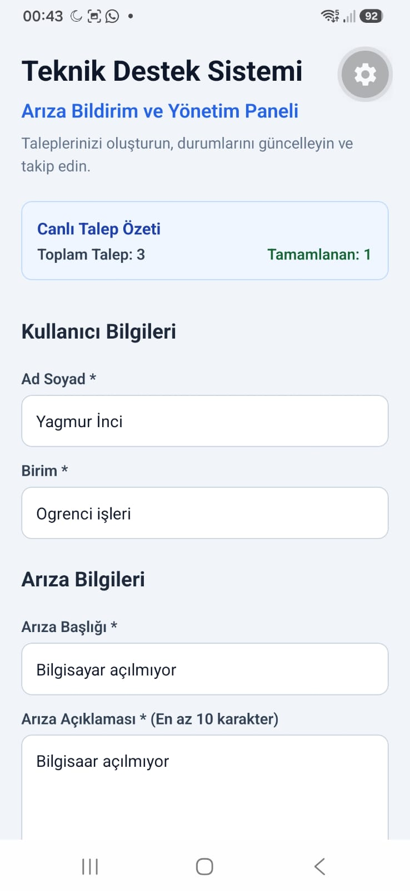<br><sub><b>Form & Canlı Sayaç</b></sub> | 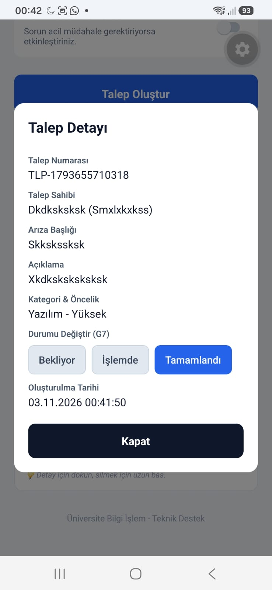<br><sub><b>Detay & Durum Değiştirme</b></sub> | 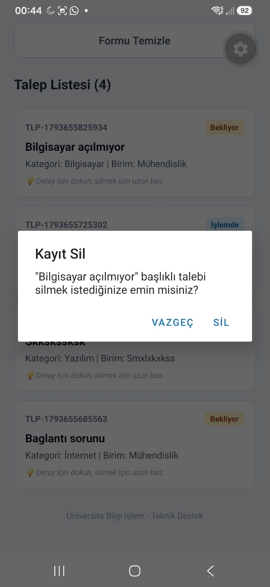<br><sub><b>Uzun Basma Silme Uyarısı</b></sub> |

---

### 📌 4. Hafta 6: Expo Router Çok Sayfalı Modüller
| 1. Ana Menü | 2. Arıza Takip Sistemi | 3. Mini Ürün Kataloğu | 4. Öğrenci Ders Programı |
| :---: | :---: | :---: | :---: |
| 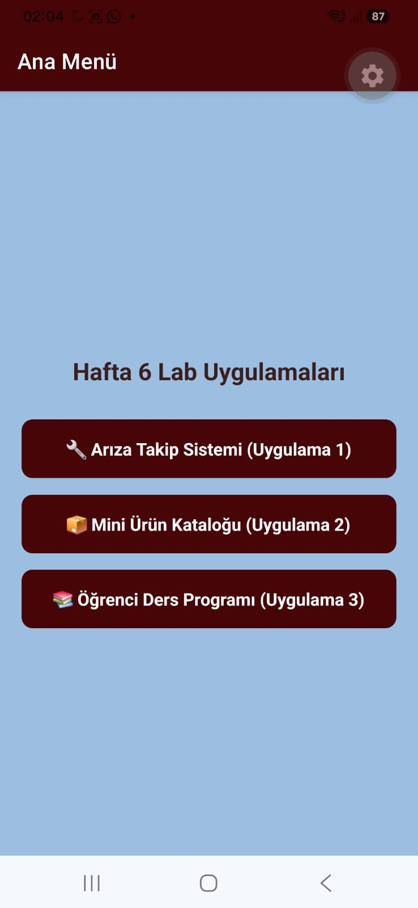<br><sub><b>Hafta 6 Ana Menü</b></sub> | 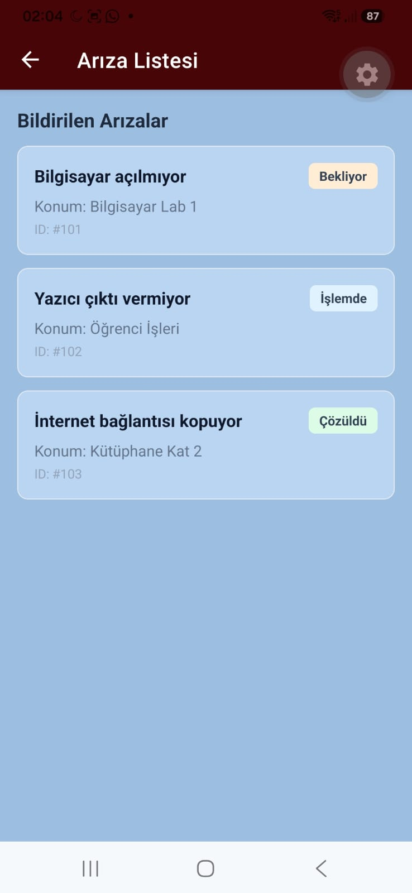<br><sub><b>Arıza Listesi & Detay</b></sub> | 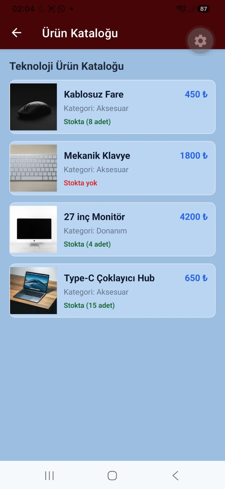<br><sub><b>Ürün Kataloğu & Detay</b></sub> | 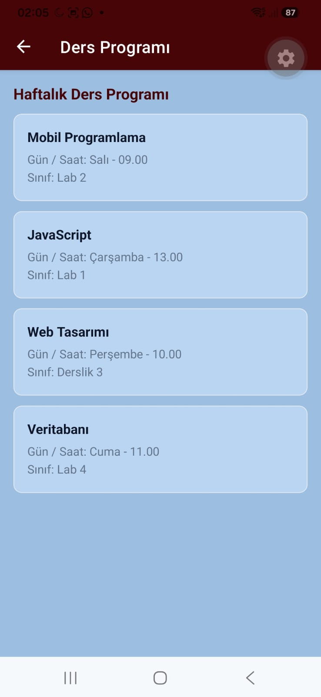<br><sub><b>Ders Programı & Detay</b></sub> |

---

### 📌 5. Hafta 7: Tema Uyumlu Günlük Plan Ekranı
| Koyu Tema (Dark Mode) | Açık Tema (Light Mode) |
| :---: | :---: |
| 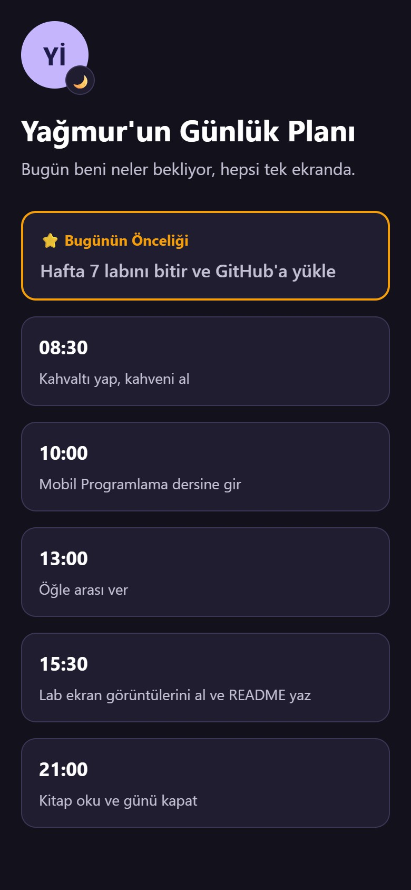<br><sub><b>Hafta 7 Lab: Koyu Temada Günlük Plan</b></sub> | 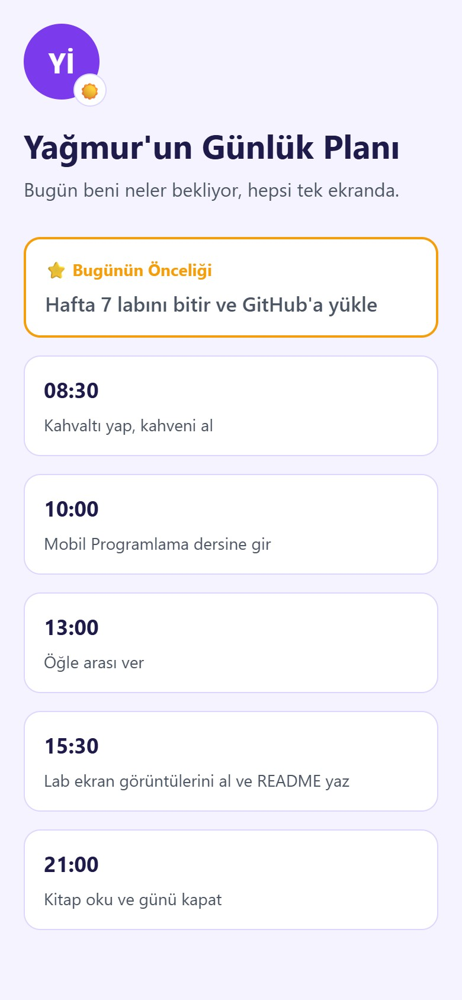<br><sub><b>Hafta 7 Lab: Açık Temada Günlük Plan</b></sub> |

---

## 🔍 Projelerin Detaylı İncelemesi

### 🔹 [Hafta 3 Lab: Kişisel Profil Kartı](./Hafta3Lab/)
- **Özet:** React Native'in `View`, `Text`, `Image`, `Pressable` bileşenleri kullanılarak oluşturulmuş kart tasarımı.
- **Teknik Detaylar:** `StyleSheet.create` ile özel flex düzeni, dairesel profil çerçevesi ve Ionicons ikon entegrasyonu.

### 🔹 [Hafta 3 (2) Lab: Gelişmiş Profil & Menü](./Hafta3_2Lab/)
- **Özet:** Yerel resim varlığı (`require('./assets/caticon2.png')`), çoklu aksiyon butonları (Profil Görüntüle ve İletişim) ve alt araç çubuğu (Ana Sayfa, Favoriler, Ayarlar).
- **Teknik Detaylar:** `elevation: 5`, esnek buton ızgarası (`flexDirection: 'row'`, `gap: 10`).

### 🔹 [Hafta 4 Lab: Bilgi İşlem Teknik Destek Paneli](./Hafta4Lab/)
- **Özet:** 8 farklı mock talep içeren yönetim paneli. Ekran boyutuna duyarlı (responsive) 4 KPI özet kartı (Toplam, Açık, İşlemde, Tamamlanan).
- **Teknik Detaylar:** `useWindowDimensions` kancası ile ekran genişliği bazlı kart boyutlandırma, `FlatList` ile performanslı listeleme, anlık filtreleme butonları ve talep durumunu adım adım ilerleten aksiyon butonları.

### 🔹 [Hafta 4 (2) Lab: Teknik Destek Talep Formu](./Hafta4_2Lab/)
- **Özet:** Kullanıcıların Ad Soyad, Birim, Arıza Başlığı ve Arıza Açıklaması girdiği kapsamlı arıza bildirim formu.
- **Teknik Detaylar:** Kategori seçici butonları, öncelik seçimi, `Switch` ile acil müdahale opsiyonu, form temizleme ve başarılı gönderim sonrasında dinamik Son Talep Kartı gösterimi.

### 🔹 [Hafta 5 Lab: Arıza Yönetim & Canlı İstatistik](./Hafta5Lab/)
- **Özet:** Form ile girilen yeni talepleri listenin başına ekleyen, canlı olarak toplam ve tamamlanan talepleri sayan sistem.
- **Teknik Detaylar:** 
  - Dokunma (`onPress`) ile açılan tam detay `Modal` penceresi.
  - Modal içerisinden talebin durumunu ("Bekliyor", "İşlemde", "Tamamlandı") anında güncelleyebilme.
  - Kart üzerine uzun basma (`onLongPress`) ile silme onay uyarısı (`Alert.alert`).

### 🔹 [Hafta 6 Lab: Expo Router Çok Sayfalı Gezinme](./Hafta6Lab/)
- **Özet:** Dosya tabanlı (file-based) modern Expo Router Stack navigasyonu. Tek proje altında 3 farklı bağımsız uygulama:
  1. **Arıza Takip Sistemi (`/ariza`):** Arıza listesi ve dinamik `[id].jsx` detay sayfası.
  2. **Mini Ürün Kataloğu (`/urun`):** Teknoloji ürünleri ve detay sayfası.
  3. **Öğrenci Ders Programı (`/ders`):** Haftalık ders takvimi ve detay sayfası.
- **Teknik Detaylar:** `router.push()`, `router.back()`, `useLocalSearchParams()`, `app/_layout.jsx` üzerinde özel bordo başlık stili (`#480507`).

### 🔹 [Hafta 7 Lab: Tema Uyumlu Günlük Plan Ekranı](./Hafta7Lab/)
- **Özet:** Derste yazılan `ThemedView`, `ThemedText`, `ThemedCard`, `ThemedLogo` ve `Spacer` bileşenleriyle hazırlanmış, logo, başlık, "Bugünün Önceliği" kartı ve günlük görev kartlarından oluşan plan ekranı.
- **Teknik Detaylar:** `constants/Colors.js` içinde açık/koyu renk paleti, `useColorScheme()` tabanlı özel `useTheme` hook'u, görevlerin diziden `map()` ile karta dönüştürülmesi ve `app.json` üzerindeki `userInterfaceStyle` ayarı ile dark mode testi.

### 🔹 [my-app: Expo Router & TypeScript Şablonu](./my-app/)
- **Özet:** Modern sekmeli (Tabs) yönlendirme yapısı, açık/koyu tema kontrolü ve TypeScript tip güvenliği.

---

## 🛠️ Genel Gereksinimler ve Kurulum

Projelerin tamamı **Node.js** ve **Expo** ortamında çalışacak şekilde hazırlanmıştır.

### 1. Depoyu Klonlayın
```bash
git clone https://github.com/YagmurInci/mobil-programlama.git
cd mobil-programlama
```

### 2. İlgili Projeyi Çalıştırma
Çalıştırmak istediğiniz projenin klasörüne girip bağımlılıkları yükleyin ve Expo'yu başlatın:

```bash
# Örnek olarak Hafta 6 projesini çalıştırmak için:
cd Hafta6Lab
npm install
npx expo start
```

### 3. Cihazda Önizleme
- **Fiziksel Cihaz:** Terminalde çıkan QR kodu telefonunuzdaki **Expo Go** uygulaması ile okutun.
- **Android Emülatör:** Terminal açıkken `a` tuşuna basın.
- **Web Tarayıcı:** Terminal açıkken `w` tuşuna basın.

---

## 👤 İletişim & Katkı

- **GitHub:** [@YagmurInci](https://github.com/YagmurInci)
- **Proje Bağlantısı:** [https://github.com/YagmurInci/mobil-programlama](https://github.com/YagmurInci/mobil-programlama)
